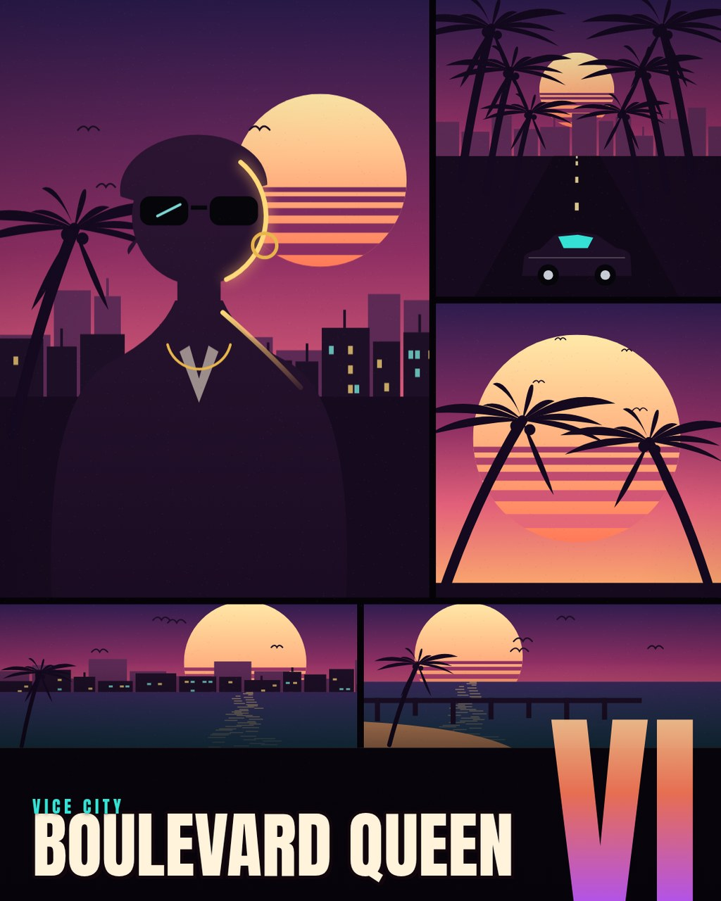

# Vice Cover Studio

[](https://make.fun/c/gta6-cover-art-01)
[](LICENSE)
[](app/index.html)

Turn any photo and caption into GTA 6-style multi-panel cover art — in your
browser, fully offline. Your photos never leave the machine: no uploads, no
network requests, no build step.

Built for the [make.fun](https://make.fun) competition
**gta6-cover-art-01 — "Make GTA 6 Cover Art"**.



## What it makes

One dominant hero panel plus supporting scenes, thick black dividers, bold
Anton lettering over a dark scrim, and a giant gradient **VI** numeral behind
the title — the poster look, in three post sizes:

| Format | Size | Layout |
| --- | --- | --- |
| Portrait | 1080 × 1350 | Asymmetric collage: hero left (~40%), car + palm-sun right, two bottom panels |
| Square | 1080 × 1080 | Four-panel mosaic, hero dominant |
| Wide | 1920 × 1080 | One wide hero panel + two stacked inserts |

Two colour grades, applied as a set rather than a uniform wash:

- **Sunset** — peach highlights, coral/pink skies, violet shadows, a little
  teal in water and signage.
- **Neon** — deep navy night, cyan and hot pink as local accents on signs and
  rim light, subjects still legible.

## The editor

- **Sample photos** — three built-in heroes, all drawn in code: a portrait
  with sunglasses and warm rim light, a neon motorcycle rider on a wet street,
  and a two-figure sunset heist with a getaway car.
- **Your own photo** — upload any image; it fills the hero panel with the same
  grade tint, drag to reframe, zoom slider to crop closer.
- **Caption** — headline + subtitle, edited live. Long headlines shrink and
  wrap to two lines automatically; the title always sits over a quiet area,
  never over eyes.
- **Supporting scenes** — five procedural backdrops (palm boulevard, palm sun,
  coastal skyline, beach pier, neon street); one button swaps the set.
- **Download PNG** — exports the exact post size, pixel for pixel with the
  preview.

## Run it

```sh
node serve.ts
# open http://localhost:8080
```

Or serve `app/` with any static file server. `file://` does not work for ES
modules — use HTTP.

Every scene is procedural Canvas 2D drawn by this app: there are no stock
photos, no external images, and no Rockstar Games logo, artwork, or font.
Lettering is [Anton](app/fonts/Anton-Regular.ttf) under the SIL Open Font
License (see [app/fonts/OFL.txt](app/fonts/OFL.txt)).

## Layout of this repo

- `app/` — the web app as static files: `index.html`, `styles.css`,
  `main.js` (editor), `cover.js` (layout engine + lettering), `scenes.js`
  (procedural scene painters), `fonts/` (bundled Anton).
- `screenshots/` — the four submission screenshots: three exported covers and
  the editor with a photo loaded. See `shots.json` for how each was taken.
- `main.ts` — the entry program: copies `app/` and `screenshots/` to
  `/output` and writes `dossier.json` with the vendored make.fun library.
- `vendor/makefun-app.ts` — the kit's library, unchanged.
- `serve.ts` — tiny static server for trying the app locally.

## License

MIT — see [LICENSE](LICENSE).
